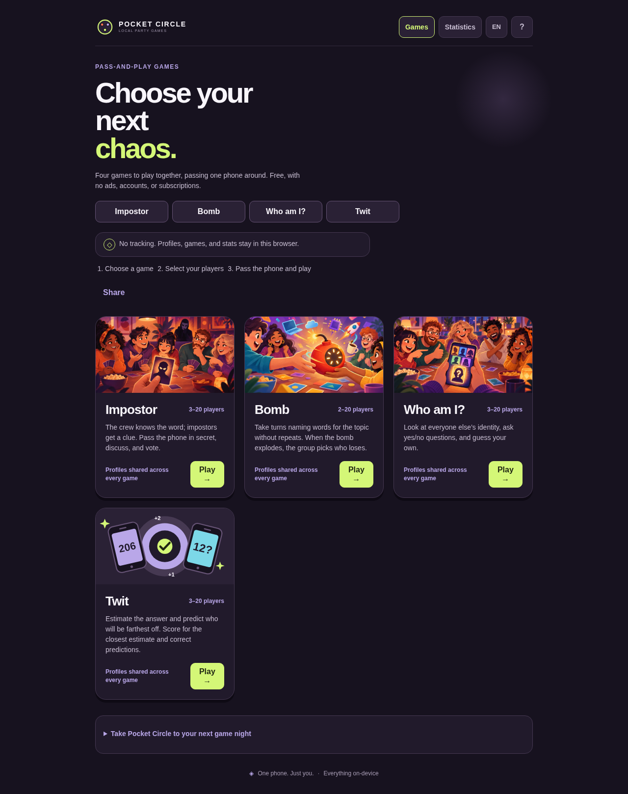

# Pocket Circle

**One phone. Your circle. Zero tracking.**

Pocket Circle is a free, open-source collection of pass-and-play party games. Hand one phone around the group, keep your secrets to yourself, and let the table handle the talking. No account, ads, analytics, or game server: profiles, active rounds, and scores stay in that browser.

[Play Pocket Circle](https://lucasforza.github.io/ImpostorGame/) · [Contribute](CONTRIBUTING.md) · [Report a bug](https://github.com/lucasforza/ImpostorGame/issues/new?template=bug_report.yml)



## Pick a game

| Game | The table does this | Players |
| --- | --- | ---: |
| **Impostore** | Share a secret word, bluff around it, then vote to find the impostors. | 3–20 |
| **Bomba** | Take turns saying topic-related answers before a hidden 45–120 second deadline; the group decides who was caught. | 2–20 |
| **Chi sono?** | Ask yes-or-no questions to work out your hidden identity. Buzz once to make a guess; a wrong guess eliminates you. | 3–20 |
| **Twit** | Estimate a number, then predict who will be farthest off. Closest earns 2 points; each correct prediction earns 1. | 3–20 |

[See the mobile catalog](marketing/screenshots/catalog-mobile.png)

Twit matches can run 1, 3, 5, or 10 rounds. The app opens in English for new players; a saved language choice is remembered. Every game and its content work offline after the first online visit and cache setup. Offline startup depends on that initial visit and the browser keeping the cache.

## Screenshots

- [Impostore](marketing/screenshots/impostore.png)
- [Bomba](marketing/screenshots/bomba.png)
- [Chi sono?](marketing/screenshots/chi-sono.png)
- [Twit](marketing/screenshots/twit.png)

## Privacy and saved games

Pocket Circle is a static web app. It has no accounts, ads, analytics, or gameplay backend. Player names, optional photos, settings, active sessions, and statistics are stored in IndexedDB for the current browser origin. They do not follow you between devices or between the GitHub Pages site and a local development server. Clearing browser site data removes them. Use one game tab per device.

Stessa Onda was retired from the playable catalog; its saved sessions and historical statistics remain supported when existing data is opened.

## Run it locally

Requires Node.js 22 or newer.

```sh
npm ci
npm run dev
```

For automated checks and a production build:

```sh
npm test
npm run build
```

`npm test` runs Vitest. `npm run build` type-checks TypeScript and writes the GitHub Pages build to `dist/`. The app uses TypeScript, Vite, and IndexedDB; see [CONTRIBUTING.md](CONTRIBUTING.md) for development notes.

## License

Pocket Circle is released under [GNU Affero General Public License v3.0 or later](LICENSE). You can inspect and modify the source in this repository. If you run a modified version for others over a network, the AGPL's source-sharing terms apply; see the license for details.

## Install and play offline

Open the published app online and expand “Take Pocket Circle to your next game night.” Wait for “Download complete” before relying on offline startup. All four games and their content are cached locally; no game-time service is needed. The browser may evict caches, and a first-ever offline visit cannot load the app.

Where supported, use your browser’s Install/Add to Home Screen option. On iPhone/iPad, use Safari → Share → Add to Home Screen. There are no installation popups. To apply an update, return online, close every Pocket Circle tab/app window, and reopen. Cached app updates do not delete IndexedDB saves.

Share the catalog or a particular game from setup/results. Native sharing falls back to copying a link, then a selectable link if clipboard access is denied. Links never include players or private game state.

## Deploy and distribute

GitHub Pages source must be **GitHub Actions**. [Deployment workflow](.github/workflows/deploy.yml) tests and builds on pushes to `main`, then publishes `dist/`. [CI](.github/workflows/ci.yml) validates branches and PRs without deploying. Keep `/ImpostorGame/` as the base path: product name is Pocket Circle; the legacy URL remains compatible with existing links and saved data. Do not rename Pages without a [migration plan](docs/naming-and-provenance.md).

```sh
npm run preview           # Serve dist after building
npx playwright install chromium
npm run test:browser      # Preview must be running
npm run qa:launch         # Offline gameplay, sharing, layouts, accessibility
npm run qa:updates        # Self-contained worker update/failure checks
npm run qa:accessibility  # Preview must be running
npm run package:itch      # Creates dist-itch/ and dist-itch.zip; does not publish
npm run validate:static   # Check both built distributions and metadata
```

Browser tests use isolated profiles and fictional names. `QA_MEDIA=1 npm run qa:launch` refreshes real screenshots. See [itch.io instructions](marketing/itch-io.md) for draft upload settings and [marketing materials](marketing/README.md) for launch copy. The itch embed has separate local data and no service worker.

## Project knowledge and trust

[Knowledge base](kb/README.md) documents game rules, localization, persistence, architecture and QA. [Launch progress](docs/launch-readiness.md) records actual checks and owner decisions. [Provenance notes](docs/naming-and-provenance.md) disclose AI assistance and historic asset-license uncertainties; no public usage ranking is claimed because there is no telemetry.

Contributions welcome: focused bug reports, accessibility checks, bilingual improvements, and clear, tested patches. Read [CONTRIBUTING.md](CONTRIBUTING.md) before opening a PR.
